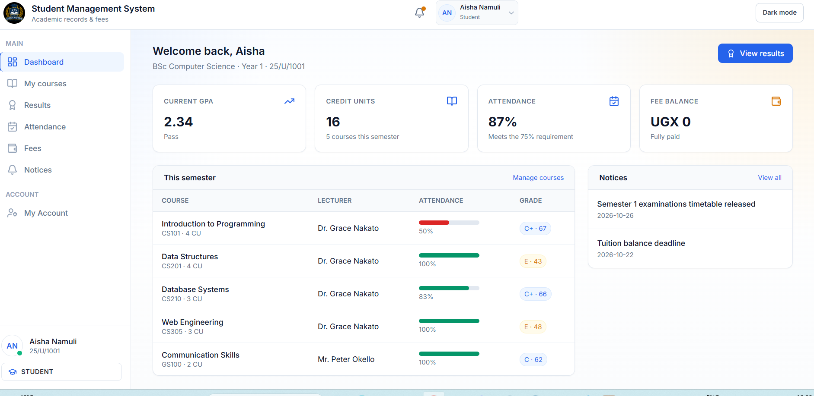
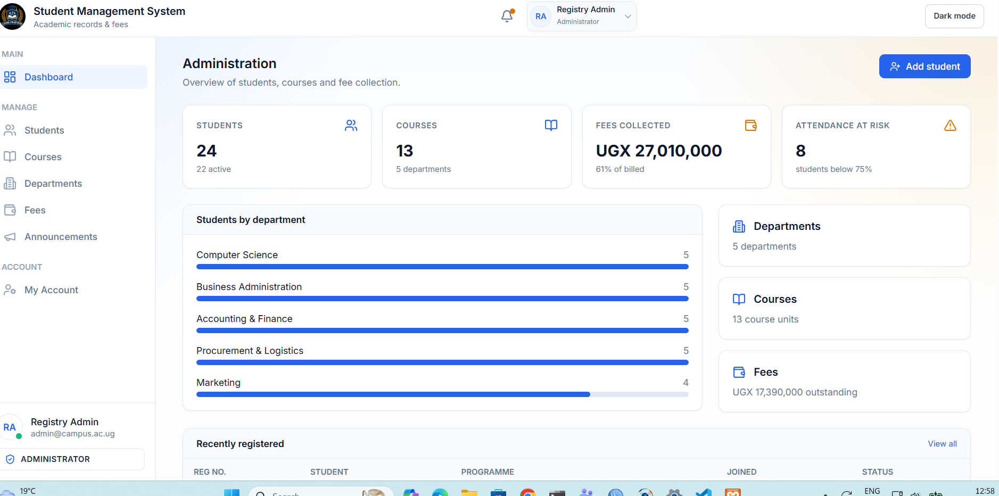
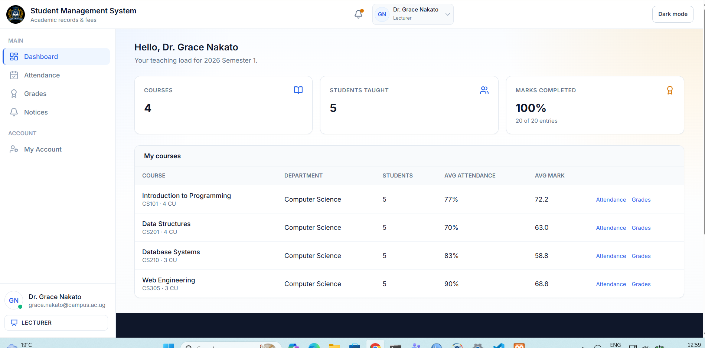
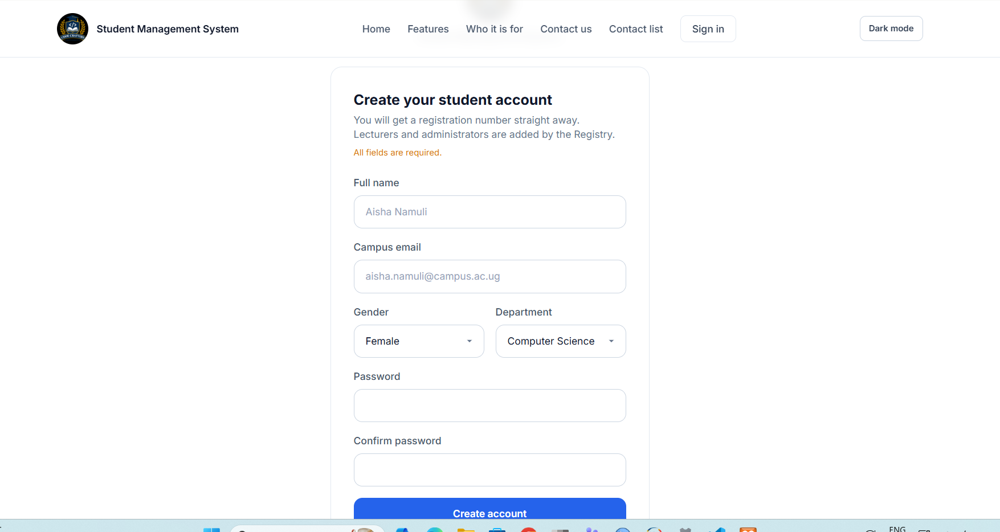
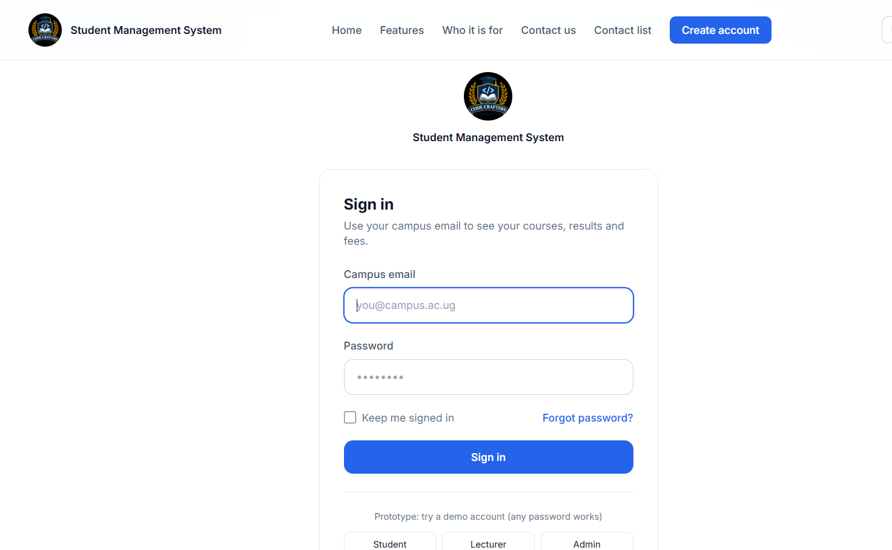

# LIST OF PARTICIPATES/GROUP MEMBERS
SSENSALO OBED              2400720223
NAMAGEMBE JAZIRAH          2400708933
MURUNGI BETH               2400707357
ATUGONZA AIDAH             2400700274
KATASI FLORENCE MWEBE      2400705435


# Student Management System

A web-based **Student Management System** built with **Laravel 12** and **MySQL** for managing students, courses, lecturers, course registrations and role-based user access. It provides three distinct areas — **Administrator**, **Lecturer** and **Student** — each with its own dashboard, navigation and permissions.

## Features

- Role-based authentication (Administrator / Lecturer / Student) with a `spatie/laravel-permission` roles & permissions layer.
- **Student management**: list with search/filter, add, view, edit, delete (admin only).
- **Course management**: list, add, view, edit, delete, with lecturer assignment (admin only).
- **Course registration**: students browse available courses, register for a course, and view or cancel their own registrations — with duplicate registration prevented at both the validation and database level.
- **Lecturer views**: read-only access to the courses assigned to them and the students registered for each.
- Reusable responsive Blade layout with a role-aware sidebar and success/error flash messages.
- Full form validation with clear, user-friendly error messages.
- Database seeders with realistic sample data and three ready-to-use demo logins.

## Technologies Used

- PHP 8.2
- Laravel 12
- MySQL (any Laravel-supported relational database works)
- Blade templating + Tailwind CSS (via CDN)
- Eloquent ORM, migrations, seeders and factories
- [spatie/laravel-permission](https://github.com/spatie/laravel-permission) for roles and permissions
- Pest for testing
- Git & GitHub

## Requirements

- PHP >= 8.2 with the PDO MySQL extension
- Composer
- MySQL (or MariaDB) running locally
- A web server (the built-in `php artisan serve` is enough)

## Installation

```bash
# 1. Clone the repository and enter the folder
git clone <your-repo-url> student-mgt-sys
cd student-mgt-sys

# 2. Install PHP dependencies
composer install

# 3. Create the environment file and generate an app key
cp .env.example .env
php artisan key:generate
```

## Database Setup

1. Make sure your MySQL server is running.
2. Create an empty database:

   ```sql
   CREATE DATABASE `student-mgt-system` CHARACTER SET utf8mb4 COLLATE utf8mb4_unicode_ci;
   ```

3. Open `.env` and confirm these values match your MySQL setup:

   ```env
   DB_CONNECTION=mysql
   DB_HOST=127.0.0.1
   DB_PORT=3306
   DB_DATABASE=student-mgt-system
   DB_USERNAME=root
   DB_PASSWORD=
   ```

## Migrations & Seeders

```bash
# Create all tables
php artisan migrate

# Create tables AND load the sample data in one step (recommended for a fresh start)
php artisan migrate:fresh --seed
```

The seeders are **idempotent** — running `php artisan db:seed` again will not create duplicate students, courses, registrations, roles or users, because every record is matched on a natural unique key (student number, staff number, course code, email).

## Sample Login Credentials

All three demo accounts use the same password. **These are example accounts for coursework demos only.**

| Role | Email | Password |
|------|-------|----------|
| Administrator | `admin@example.com` | `password123` |
| Lecturer | `lecturer@example.com` | `password123` |
| Student | `student@example.com` | `password123` |

The student and lecturer demo accounts are already linked to their `student` / `lecturer` profiles, so their dashboards and registration features work immediately after logging in.

> Account provisioning is intentionally handled by the **Administrator**. The public register page is a placeholder — new student/lecturer accounts are created and given roles by an admin, which is the standard university workflow.

## User Roles

- **Administrator** — manages students, courses and registrations, and views system-wide information. This is the only role that can create, edit and delete records.
- **Lecturer** — read-only access to the courses assigned to them and the students registered in those courses. Cannot access any administrator functionality.
- **Student** — browses available courses, registers for courses, and views or cancels only their own registrations. Can never view or modify another student's records.

Authorization is enforced with `auth` + `role:*` middleware on every protected route, so a user from one role cannot open another role's pages (they receive a 403 Forbidden or 404).

## Running the Application

```bash
php artisan serve
```

Then open **http://127.0.0.1:8000** in your browser and sign in with a sample account.

## Testing

The project uses [Pest](https://pestphp.com/). Tests cover authentication, role protection, CRUD, unique-field validation and duplicate-registration prevention.

```bash
php artisan test --compact
```

## Project Structure (key files)

```
app/Models/            Student, Lecturer, Course, CourseRegistration, User
app/Http/Controllers/  Auth, Dashboard, Student, Course, Registration, Lecturer
database/migrations/   schema for all tables
database/seeders/      RolePermissionSeeder, DataSeeder
resources/views/       layouts/app + admin/, lecturer/, student/ Blade views
routes/web.php         public, auth and role-protected route groups
```

## Database Relationships

- `Lecturer` **hasMany** `Course` — a lecturer is assigned many courses.
- `Course` **belongsTo** `Lecturer` — each course has one responsible lecturer.
- `Student` **belongsToMany** `Course` (through `course_registrations`) — many-to-many.
- `Course` **belongsToMany** `Student` (through `course_registrations`).
- `CourseRegistration` **belongsTo** both `Student` and `Course` — it stores registration info (status, date) and the composite unique index on `(student_id, course_id)` blocks duplicates.


## Screenshots

```
  
```


  
  